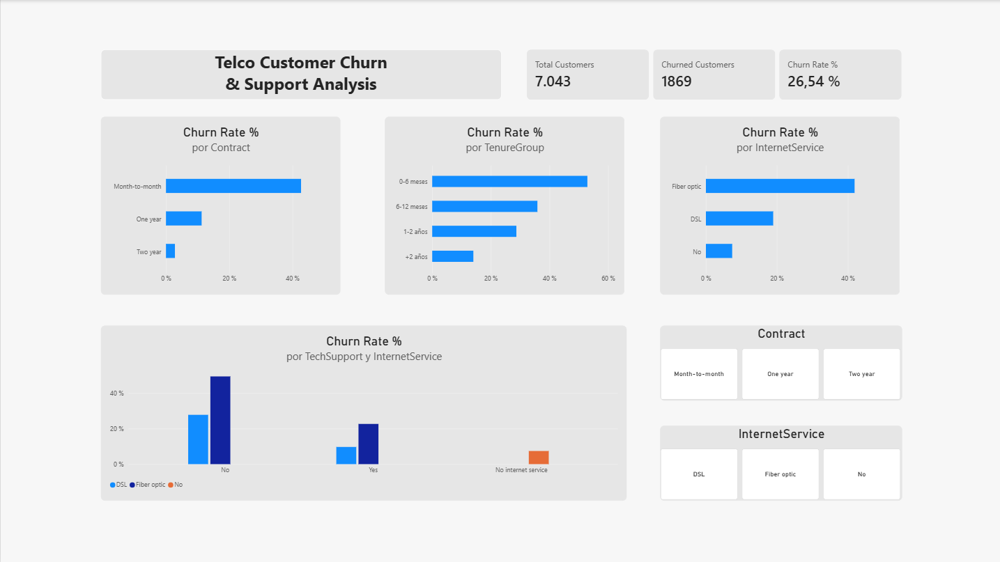

# Telco Customer Churn & Technical Support Analysis

## Project Overview
Customer retention is one of the most critical challenges in the telecommunications industry. In this end-to-end data analysis project, I explored a dataset of **7,043 telecom customers** to identify the primary drivers behind service cancellation (**churn**) and evaluate how technical support impacts retention among high-value internet subscribers.

**Tools & Technologies Used:**
* **Python (Pandas):** Data auditing, type casting, null handling, and feature engineering.
* **SQL (SQLite):** Business querying, customer segmentation, and revenue impact calculation.
* **Power BI:** Interactive executive dashboard design and DAX measures.

---

## Key Business Findings
1. **High Overall Churn & Revenue Impact:** The company faces a **26.54% overall churn rate** (1,869 lost customers), representing significant recurring monthly revenue loss.
2. **Early-Stage Vulnerability:** Customers within their **first 6 months** of tenure exhibit the highest abandonment rate compared to long-term subscribers.
3. **Contract Flexibility Risk:** Subscribers on **Month-to-Month contracts** churn at dramatically higher rates than those committed to one- or two-year agreements.
4. **The Fiber Optic & Tech Support Gap:** While **Fiber Optic** is the highest-tier internet product, it suffers from the highest churn rate among internet services. Crucially, among Fiber Optic subscribers **without Technical Support (`TechSupport = No`)**, the churn rate spikes to nearly **50%**.

---

## Actionable Recommendations
* **Onboarding Support Bundle:** Include complimentary Technical Support during the first 6 months for new Fiber Optic, month-to-month subscribers to reduce early friction and prevent cancellations.
* **Proactive CRM Alerts:** Flag new Fiber Optic customers who log repeat technical tickets without a support plan so retention/support agents can intervene early.
* **Contract Migration Incentives:** Offer targeted loyalty discounts at month 4 or 5 to transition high-risk month-to-month users into annual contracts.

---

## Dashboard Preview


---

## Repository Structure
```text
├── data/
│   ├── raw/                 # Original dataset (IBM Telco Customer Churn)
│   └── processed/           # Cleaned dataset & SQLite database
├── notebooks/
│   ├── 01_data_exploration.ipynb   # Data cleaning & feature engineering in Python
│   └── 02_sql_analysis.ipynb       # SQLite database setup & query execution
├── sql/
│   └── churn_business_queries.sql  # Standalone SQL business queries
├── powerbi/
│   ├── images/                     # Dashboard screenshots
│   └── telco_churn_dashboard.pbix  # Power BI report file
└── README.md
```

---

## Author
**Jonathan Ezequiel Ilardi**  
* [LinkedIn](https://www.linkedin.com/in/jonilardi/)
